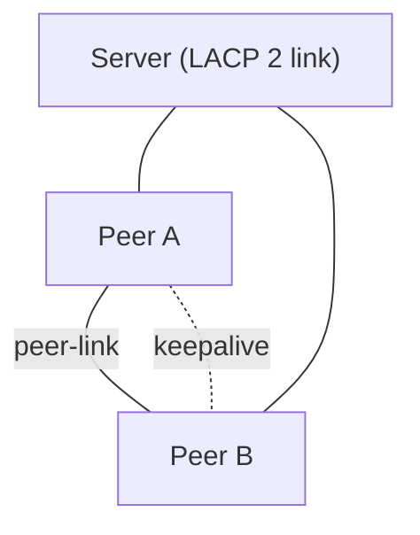

## 1. Vì sao cần biết

LACP chuẩn chỉ gộp link tới một switch, nên switch trở thành điểm lỗi đơn (SPOF). Với datacenter,
server/hypervisor/storage cần nối vào 2 switch khác nhau mà vẫn dùng được cả hai đường và không
bị STP chặn. MLAG (Multi-Chassis Link Aggregation) giải quyết bằng cách để 2 switch giả làm
1 thiết bị logic với đối tác. Bài này nêu khái niệm; chi tiết lệnh phụ thuộc hãng.

## 2. Khái niệm cốt lõi

- **MLAG**: tên chung; Cisco gọi **vPC** (Nexus), Arista MLAG, Juniper MC-LAG, Dell VLT.
- **vPC domain**: cặp 2 switch (peer) cùng domain ID, trình bày với thiết bị downstream như 1 hệ LACP duy nhất.
- **Peer-link**: link (thường port-channel tốc độ cao) giữa 2 peer để đồng bộ trạng thái (MAC, cấu hình) và chuyển lưu lượng khi cần.
- **Peer-keepalive**: kênh riêng (thường qua mạng quản trị, không đi qua peer-link) để phát hiện peer sống/chết — giúp tránh split-brain.
- **vPC member port**: port-channel nối xuống server/switch downstream, có cùng vPC ID ở hai peer.
- Với dự phòng gateway: dùng FHRP (HSRP/VRRP) hoặc anycast gateway, xem module routing.



## 3. Cách nó hoạt động

Server nhìn 2 switch qua 2 link như cùng 1 partner LACP (cùng system ID) nên bundle bình thường.
Mỗi peer đồng bộ bảng MAC/ARP với peer kia qua peer-link. Lưu lượng đi qua link cục bộ để tránh
vượt peer-link (nguyên tắc: peer-link chỉ nên chở lưu lượng bất thường).

**Khi peer-link đứt**: peer thứ yếu (secondary) dùng keepalive kiểm tra peer chính còn sống; nếu còn, secondary tắt vPC member port của nó để tránh hai bên cùng chuyển tiếp (split-brain). Nếu cả peer-link và keepalive đều mất, có thể xảy ra split-brain — vì thế keepalive phải đi đường độc lập.

**Lưu ý thiết kế:** cấu hình vPC phải nhất quán hai peer (VLAN, STP mode, MTU) — có cơ chế kiểm tra consistency; lệch cấu hình có thể làm vPC bị treo (suspended). Thứ tự nâng cấp phần mềm cũng cần theo hướng dẫn hãng — TODO-VERIFY với tài liệu phiên bản đang dùng.

## 4. Thực hành

Không có thiết bị Nexus trong môi trường soạn bài, nên cấu hình dưới đây là **ví dụ minh họa** theo cấu trúc NX-OS, cần đối chiếu tài liệu phiên bản của bạn:

```
feature vpc
feature lacp
vpc domain 10
  peer-keepalive destination 10.0.0.2 source 10.0.0.1 vrf management
interface port-channel1
  switchport mode trunk
  vpc peer-link
interface port-channel20
  switchport mode trunk
  vpc 20
```

Lệnh kiểm tra thường dùng: `show vpc`, `show vpc consistency-parameters`, `show port-channel summary`.

Phía server Linux không cần biết vPC, chỉ cấu hình bond 802.3ad bình thường (xem bài LACP) và nối mỗi NIC vào một peer.

## 5. Lỗi thường gặp và cách chẩn đoán

**vPC bị suspended / consistency check fail**
- Nguyên nhân: cấu hình hai peer lệch (allowed VLAN, STP mode, MTU).
- Xác nhận: `show vpc consistency-parameters`. Xử lý: đồng bộ cấu hình.

**Peer-keepalive đi qua peer-link**
- Nguyên nhân: thiết kế sai. Hậu quả: đứt peer-link thì mất luôn keepalive → split-brain. Xử lý: đưa keepalive sang mạng quản trị/VRF riêng.

**Server chỉ lên 1 link**
- Nguyên nhân: vPC ID không khớp hai peer hoặc LACP không thoả thuận. Xác nhận: `show vpc`, `/proc/net/bonding/bond0` phía Linux.

## 6. Tình huống thực tế

Bảo trì switch peer A (reboot). Server bond 2 NIC, nghĩ rằng mất 1 link vẫn ổn nhưng bị gián đoạn vài giây.

1. Kiểm tra bond: `lacp_rate slow` nên phát hiện link chết lâu (tối đa vài chục giây).
2. Đổi `lacp_rate fast` và `miimon 100` cho bond — failover nhanh hơn.
3. Lập kế hoạch bảo trì: chuyển lưu lượng khỏi peer A trước (graceful), reboot từng peer một, kiểm tra `show vpc` giữa các bước.
4. Ghi runbook: bảo trì từng peer, xác nhận cả hai đã đồng bộ lại trước khi động tới peer kia.

## 7. Tự kiểm tra

**Câu 1**: Vấn đề nào của LACP chuẩn mà MLAG/vPC giải quyết?

a) LACP chuẩn chỉ nối tới một switch duy nhất; MLAG/vPC cho phép server nối tới hai switch vật
   lý khác nhau, loại bỏ điểm lỗi đơn (SPOF) mà vẫn dùng được cả hai link
b) LACP chuẩn không hỗ trợ tốc độ trên 1Gbps; MLAG/vPC cho phép gộp link tốc độ cao hơn
c) LACP chuẩn không mã hoá được LACPDU; MLAG/vPC bổ sung mã hoá cho gói điều khiển
d) LACP chuẩn chỉ hoạt động trên switch của một hãng; MLAG/vPC cho phép gộp link giữa switch
   khác hãng

**Đáp án: a** — LACP chuẩn chỉ nối tới 1 switch; MLAG cho nối tới 2 switch khác nhau, loại SPOF
mà vẫn dùng cả hai link. Vấn đề LACP chuẩn không nằm ở giới hạn tốc độ (loại b); không liên
quan tới mã hoá LACPDU (loại c); và không liên quan tới khác hãng thiết bị — vấn đề cốt lõi là
số lượng đối tác logic LACP chuẩn hỗ trợ (chỉ 1), không phải tương thích đa hãng (loại d).

---

**Câu 2**: Peer-keepalive để làm gì và vì sao không nên đi qua peer-link?

a) Để đồng bộ bảng MAC giữa hai switch; đi qua peer-link giúp đồng bộ nhanh hơn nên luôn nên
   dùng chung đường đó
b) Phát hiện peer còn sống (sống/chết) để tránh tình trạng split-brain; nếu đi qua chính
   peer-link thì khi peer-link đứt, keepalive cũng mất theo — không còn cách phát hiện
   split-brain
c) Để đo độ trễ giữa hai switch nhằm tối ưu thuật toán chọn link; không liên quan tới split-brain
d) Để backup cấu hình giữa hai switch; đi qua đường riêng chỉ để tránh tốn băng thông peer-link

**Đáp án: b** — Phát hiện peer còn sống để tránh split-brain; nếu đi qua peer-link thì đứt
peer-link làm mất cả keepalive. Peer-keepalive không dùng để đồng bộ MAC table, đó không phải
vai trò của nó (loại a); mục đích chính là phát hiện split-brain, không phải đo độ trễ (loại
c); không liên quan tới backup cấu hình (loại d) — lý do dùng đường riêng là chính xác (tránh
mất keepalive khi peer-link đứt), nhưng mục đích của keepalive bị mô tả sai ở lựa chọn này.

---

**Câu 3**: Server có cần cấu hình đặc biệt cho vPC không?

a) Có, server cần cài driver vPC riêng để nhận diện cả hai switch là một thực thể logic
b) Có, server cần cấu hình 2 địa chỉ IP quản lý tương ứng với 2 switch
c) Không — server chỉ cần cấu hình LACP chuẩn như bình thường; toàn bộ phần phối hợp vPC nằm ở
   phía switch, trong suốt với server
d) Không cần cấu hình, nhưng server phải hỗ trợ phần cứng NIC đặc thù của hãng switch đang dùng
   vPC

**Đáp án: c** — Không, chỉ LACP chuẩn; vPC nằm ở phía switch. Server không cần driver vPC riêng
— với server, bundle vẫn chỉ là LACP chuẩn bình thường (loại a); không cần cấu hình IP quản lý
tương ứng với từng switch, server chỉ thấy MỘT đối tác LACP logic (loại b); không yêu cầu NIC
đặc thù của hãng switch — đây là một lợi thế chính của vPC, bất kỳ NIC hỗ trợ LACP chuẩn đều
dùng được (loại d).

## 8. Bài liên quan và nguồn tham khảo

**Bài liên quan trong module này:** `networking.switching.lacp`, `networking.switching.stp`

**Nguồn tham khảo:**
- [Linux Ethernet Bonding Driver HOWTO — kernel docs](https://docs.kernel.org/networking/bonding.html) — phía server.
- Tài liệu vPC của hãng (Cisco Nexus vPC Configuration Guide) — TODO-VERIFY: chưa fetch/kiểm tra URL đúng phiên bản.
